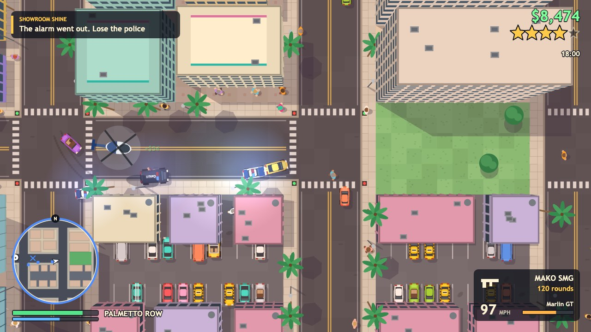

# low-tide-kings

[](https://make.fun/bounty/gta6-01?utm_source=github&utm_medium=readme&utm_campaign=gta6-01)
[](https://make.fun/bounty/gta6-01/leaderboard?utm_source=github&utm_medium=readme&utm_campaign=gta6-01)
[](https://make.fun/bounty/gta6-01?utm_source=github&utm_medium=readme&utm_campaign=gta6-01)

**LOW TIDE KINGS** is an original open-world crime game for the desktop browser, set in the
fictional, sun-soaked city of Marazul Bay. Dani Okoro comes home to find developer Lucien Marrow
buying up the waterfront, and her cousin Tavo's boatyard is next. Steal cars, outrun the Marazul
Bay Police Department, and take the bay back over five story missions.

It is plain Canvas 2D and ES modules: no library, no build step, no image or audio files (every
picture is drawn in code and every sound is synthesised with Web Audio) and no network request.



## Run it

Needs Node.js 22 or later and desktop Chrome.

```sh
node serve.ts
```

Then open http://localhost:8080. (`node serve.ts --port 9000` serves on another port.)

To write the hand-in bundle (the game, the screenshots and `dossier.json`):

```sh
mkdir -p out && MAKEFUN_OUTPUT_DIR=out node main.ts
```

## What is in the game

- **Marazul Bay**: eight districts (Corona Heights, Sawgrass Park, Barrio Coral, Vista Centro,
  Palmetto Row, Playa Dorada, Ironwharf and Isla Perla across the bridge) with towers, shops,
  villas, parks, beaches, piers and docks, drawn in a leaning fake-3D top-down view.
- **On foot and at the wheel**: eleven vehicles with arcade handling, drifting, handbrake turns,
  damage, fire and explosions. Any car can be stolen, parked or moving, police cars included.
- **A living city**: traffic that keeps its lane and obeys signals, pedestrians who stroll, cross
  the street and run from trouble.
- **Wanted level**: one to five stars. Cruisers hunt along the road network, officers get out to
  arrest or shoot, armoured Bulwarks join at four stars and a helicopter with a searchlight flies
  from three. Break the line of sight, or get a respray, to lose them.
- **Combat**: fists, the Tidewater 9 pistol, Mako SMG, Breaker 12 shotgun and Longfin AR, against
  Marrow's gang, the Tidemen.
- **Story**: five missions (Homecoming, Collection Day, Showroom Shine, Front Page, Low Tide)
  with dialogue, objectives, timers, rewards and unlocks.
- **Side activities**: Bay Cab taxi fares, sixteen golden conch shells to find, cash, health and
  armour pickups.
- **Places**: the Casa Coral safehouse (rest and save), the Brine & Barrel gun shop, FreshCoat
  Auto (respray, repair and a clean record) and St. Brisa Medical.
- **HUD and menus**: round minimap with blips, full city map, health and armour, money, wanted
  stars, clock, district, weapon and ammunition, speedometer, objectives, title screen, pause
  menu with statistics, controls sheet.
- **Day and night**: a twelve-minute day with long shadows, sunsets, street lamps, headlights
  and lit windows.
- **Sound**: synthesised effects, engine, sirens and helicopter, and a three-station car radio
  whose music is composed in code.
- **Saving**: progress is kept in the browser (safehouse, F5 quick save, pause menu, and
  automatically after each mission). CONTINUE on the title screen picks it up.

## Controls

| Keys | Action |
| --- | --- |
| W A S D / arrows | Walk · steer, accelerate, brake and reverse |
| Mouse | Aim |
| Left click / Space | Attack (Space is the handbrake when driving) |
| Shift | Sprint |
| F or E | Steal, enter or leave a vehicle |
| Q · 1-5 · mouse wheel | Switch weapon |
| R | Next radio station |
| H | Horn |
| G | Start or stop Bay Cab fares (in a taxi) |
| Enter | Use a shop or the safehouse · next line of dialogue |
| M | City map |
| F5 | Quick save |
| Esc / P | Pause |

## Layout

- `game/index.html`, `game/src/`: the game. Each file has one job: `city/` builds the map and
  road network, `entities/` holds vehicles and people, `ai/` drives traffic, pedestrians and
  gang members, `police/` runs the wanted level and the response to it, `combat/` weapons and
  damage, `missions/` the story and the taxi job, `world/` the simulation step, pickups, shops
  and the day cycle, `render/` everything drawn in the world, `ui/` the HUD, minimap and
  menus, `audio/` sound effects and the radio, `save/` saved games.
- `screenshots/`: four frames rendered by the game's own code (`shots.json` lists the scenes;
  `?shot=chase|drive|shootout|start` stages each one from real game state).
- `main.ts`: copies the game and screenshots to the output directory and writes the dossier.
- `serve.ts`: a tiny static server for local play.

Everything here (the city, names, characters, vehicles, story, art, sounds and music) is
original to this game. MIT licensed.

Built for [make.fun · gta6-01](https://make.fun/bounty/gta6-01).
